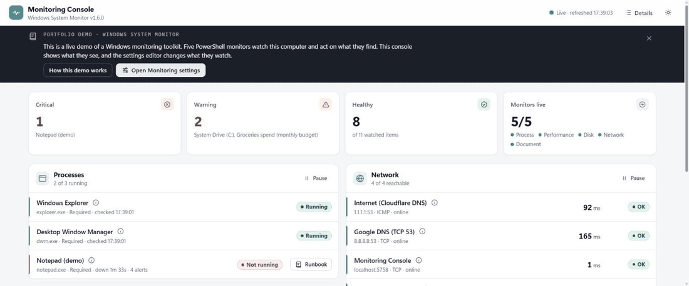
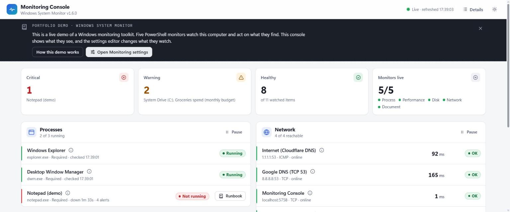
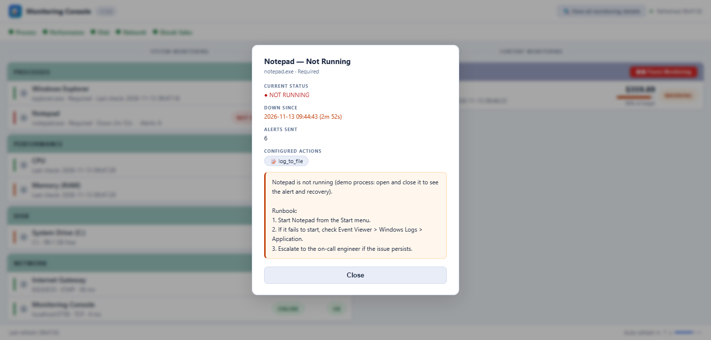
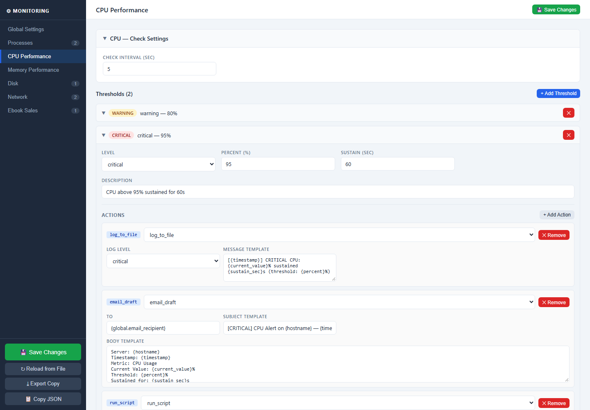
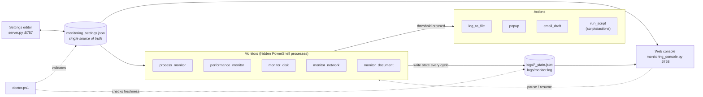

# Windows System Monitor

[](https://github.com/carlosgild-web/windows-system-monitor/actions/workflows/ci.yml)
[](LICENSE)


**A config-driven monitoring and auto-remediation toolkit for Windows.** Describe what to watch in one JSON file:
processes, CPU, memory, disk, network, or a business metric from a spreadsheet. Background monitors
check it on their own schedules, fire escalating actions when something crosses a threshold, and report to a
live web dashboard.



---

## Highlights

- **One source of truth.** `monitoring_settings.json` defines every monitor, threshold and response. Every other
  component reads it, and a browser-based editor writes it.
- **Five independent monitors.** Each one runs in its own hidden PowerShell process, so a failure in one doesn't take down the others.
- **Escalating actions without alert spam.** `log_to_file`, desktop `popup`, `email_draft` and `run_script`
  remediation. Hysteresis keeps a value hovering at a threshold to one incident, popups and emails fire once per
  incident, and an email cooldown caps drafts per alert; logging and remediation keep running while the problem lasts.
- **Live web console.** Merges the monitors' state files with a real-time process check, lets you pause and resume
  each monitor, and shows a runbook for each failing process. Light and dark themes, and a built-in demo guide
  ("How this demo works") for anyone trying it out.
- **Self-diagnosing.** `doctor.bat` checks the environment, config schema, paths and running monitors. The launcher
  runs the same checks before starting anything, so a bad config fails loudly instead of silently.
- **Tested.** 100+ Pester tests and a Python test suite, run on Windows PowerShell 5.1 in GitHub Actions.
- **No dependencies beyond Windows and Python.** The web servers use only the Python standard library.

## Screenshots

| Live console | Process runbook | Settings editor |
|---|---|---|
| [](docs/screenshots/console.png) | [](docs/screenshots/console-instructions.png) | [](docs/screenshots/editor.png) |

## Architecture



The monitors never talk to the console directly. Each one writes a small JSON state file. The console reads the
files and treats a monitor as alive only if its file was updated within `2 × check interval + 15 s`. A
crashed or hung monitor therefore shows up as stale; it can't look healthy.

## Quick start

**Requirements:** Windows 10/11, Windows PowerShell 5.1 (built in), and Python 3 on `PATH`.
Microsoft Excel is optional: the document monitor reads CSV files without it, and needs Excel only for `.xlsx`.

```bat
git clone https://github.com/carlosgild-web/windows-system-monitor.git
cd windows-system-monitor

doctor.bat             :: health check: environment, config, paths
start_monitoring.bat   :: preflight, start all monitors, open the console at http://localhost:5758
start_editor.bat       :: settings editor at http://localhost:5757
stop_monitoring.bat    :: stop everything
```

The default config is a **test environment that works on any Windows PC**: Explorer and the Desktop Window Manager,
CPU and RAM, the `C:` drive, two public DNS servers, and a made-up budget CSV, plus demo toggles. To see an alert end
to end, open and then close **Notepad**: within about 30 seconds the console shows it as *NOT RUNNING* with an alert
count, and `logs/monitor.log` records the event and its recovery. **[How to trigger every alert →](docs/test-environment.md)**

### Try it without Windows (Docker)

```bash
docker compose up --build        # console: http://localhost:5758   editor: http://localhost:5757
```

The real web console and settings editor, fed by simulated monitors. The banner says so. Why the monitors themselves
can't run in a container is explained in **[docs/docker.md](docs/docker.md)**.

### What the doctor reports

Abbreviated output from a healthy system:

```text
  Environment
    [OK  ] PowerShell 5.1.26100
    [OK  ] python on PATH  -  C:\Python314\python.exe
  Config
    [OK  ] Schema valid  -  All sections, thresholds and actions are well-formed
  Paths
    [OK  ] run_script on_cpu_critical.ps1  -  performance.cpu.thresholds[1]
    [OK  ] Document file  -  sample_data\monthly_budget_sample.csv
  Runtime
    [OK  ] process monitor  -  PID 18660, state updated 13s ago
    [OK  ] Console port 5758  -  in use by this project (PID 5652)
  ============================================================
   25 OK   0 WARN   0 FAIL
```

A broken config produces specific findings, and the exit code is the number of failures. For example:

```text
    [FAIL] performance.cpu.thresholds[0].percent  -  Must be a number between 1 and 100
    [FAIL] network[1].protocol  -  'udp' must be icmp or tcp
    [FAIL] run_script on_disk_critical.ps1  -  Not found: ...\on_disk_critical.ps1 (action is silently skipped)
    [WARN] disk[0].thresholds[0].actions[0] (log_to_file)  -  Uses 'instructions'; disk actions should use 'message_template'
```

## Configuration at a glance

```json
"performance": {
  "cpu": {
    "check_interval_sec": 5,
    "thresholds": [
      { "level": "warning",  "percent": 80, "sustain_sec": 30,
        "actions": [ { "type": "log_to_file", "level": "warning",
                       "message_template": "[{timestamp}] WARNING CPU: {current_value}% for {sustain_sec}s" } ] },
      { "level": "critical", "percent": 95, "sustain_sec": 60,
        "actions": [ { "type": "log_to_file", "...": "..." },
                     { "type": "email_draft", "to": "{global.email_recipient}", "...": "..." },
                     { "type": "run_script",  "path": "{global.scripts_dir}\\actions\\on_cpu_critical.ps1",
                       "args": ["--level", "critical", "--value", "{current_value}"] } ] }
    ]
  }
}
```

| Monitor | Checks | Triggers on |
|---|---|---|
| Process | Required executables are running | Running ⇄ down transitions |
| Performance | CPU % and RAM % | A level held for `sustain_sec` |
| Disk | Percent used per drive | `percent_used` thresholds |
| Network | ICMP ping or TCP connect | Latency (`latency_ms`) or `"unreachable"` |
| Document | Sum of a filtered column in a `.csv` or `.xlsx` | Total `above` or `below` a percent of a target |

The full schema, template variables and action reference are in **[docs/configuration.md](docs/configuration.md)**.

## Testing

```powershell
python -m unittest discover -s tests/python -v      # editor server + console logic
Invoke-Pester tests/powershell                      # requires Pester 5.5+
```

- **Static checks on every script:** it parses; no non-ASCII string literals (PowerShell 5.1 reads files as
  Windows-1252); no assignments to automatic variables such as `$PID`; no `Set-StrictMode -Version Latest`;
  every monitor handles every action type.
- **Doctor:** each schema rule is tested by mutating the shipped config and checking for the expected failure.
- **Editor server:** settings round-trip; CSRF and DNS-rebinding rejection; invalid bodies; path traversal on
  `/api/open-file`.
- **Console:** freshness windows, live-check override, and corrupt, missing or BOM-prefixed files.

[CI](.github/workflows/ci.yml) runs all of the above, plus PSScriptAnalyzer and the doctor, on `windows-latest`.

## Project structure

```text
├── monitoring_settings.json      # the single source of truth
├── start_monitoring.bat          # preflight + launch all monitors + console
├── stop_monitoring.bat
├── start_editor.bat
├── doctor.bat
├── server.py                     # settings editor backend (stdlib HTTP server, :5757)
├── monitoring_editor.html        # settings editor UI
├── MonitoringConsole/
│   └── monitoring_console.py     # live dashboard backend (stdlib HTTP server, :5758)
├── web/
│   ├── console.html              # live dashboard page
│   └── static/                   # shared theme (light/dark), SVG icons, served at /static/ by both servers
├── scripts/
│   ├── process_monitor.ps1       # one script per monitor
│   ├── performance_monitor.ps1
│   ├── monitor_disk.ps1
│   ├── monitor_network.ps1
│   ├── monitor_document.ps1
│   ├── start_monitoring.ps1      # launcher with preflight
│   ├── stop_monitoring.ps1
│   ├── doctor.ps1
│   ├── run_hidden.vbs            # windowless launch (see design notes)
│   ├── actions/                  # sample run_script remediation handlers
│   └── lib/                      # MonitorCommon, MonitorActions, DocumentReader, ActionHandler, Doctor
├── sample_data/                  # made-up budget CSV (default) and a sample workbook
├── docker/                       # demo container: simulator, entry point, smoke test
├── Dockerfile, docker-compose.yml
├── tests/                        # Pester + Python unittest suites
└── docs/                         # configuration reference, design decisions, screenshots
```

## Design decisions

The short version (details and trade-offs in **[docs/design-decisions.md](docs/design-decisions.md)**):

- **Files as the integration layer.** Monitors write JSON state files and the console reads them. There's no broker
  and no shared process, and staleness doubles as a heartbeat.
- **PowerShell for collection, Python for the UI.** PowerShell 5.1 ships with every Windows install and has
  first-class WMI/CIM and performance counters. Python's standard library provides a dependency-free web server.
- **Fail loudly, run quietly.** Monitors run hidden and keep their loops alive, so the doctor and the launcher's preflight
  make configuration problems visible *before* anything starts.
- **Localhost-only, same-origin APIs.** Both servers bind to `localhost` and reject cross-origin or rebinding
  requests, so a malicious web page can't rewrite the config or trigger actions.
- **Docker runs the demo, not the monitors.** The monitors depend on WMI, perf counters, Excel COM and the Windows
  desktop, which a container is isolated from by design. The image runs the real console and editor with simulated
  monitors instead. See [docs/docker.md](docs/docker.md).

## Roadmap

- Read the workbook with `openpyxl` instead of Excel COM: no Office dependency, much faster cycles.
- Optional SMTP delivery alongside the current `mailto:` drafts.
- Run the monitors as a Windows service (e.g. via NSSM) instead of a logged-in session.
- Cross-platform collectors (`psutil`) running on the host, so the containerized dashboard could show real data.

## More

- ⚙️ [Configuration reference](docs/configuration.md)
- 🧭 [Design decisions](docs/design-decisions.md)
- 📝 [Changelog](CHANGELOG.md)

## License

[MIT](LICENSE)
