<p align="center"></p>

# 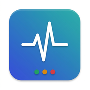 Windows System Monitor

[](https://github.com/carlosgild-web/windows-system-monitor/actions/workflows/ci.yml)
[](LICENSE)


**For anyone who keeps a Windows PC or a small fleet running:** five PowerShell monitors watch processes, CPU,
memory, disks, network and a business number in a spreadsheet, from one JSON file, and act when a threshold is
crossed: a log line, a popup, a ServiceNow-style ticket with an email draft, a remediation script. When an
incident opens, a small model running on the same PC (Ollama) explains it from the monitors' own data and drafts
the ticket text, with tools that can only read. **The AI explains; the monitors decide.**

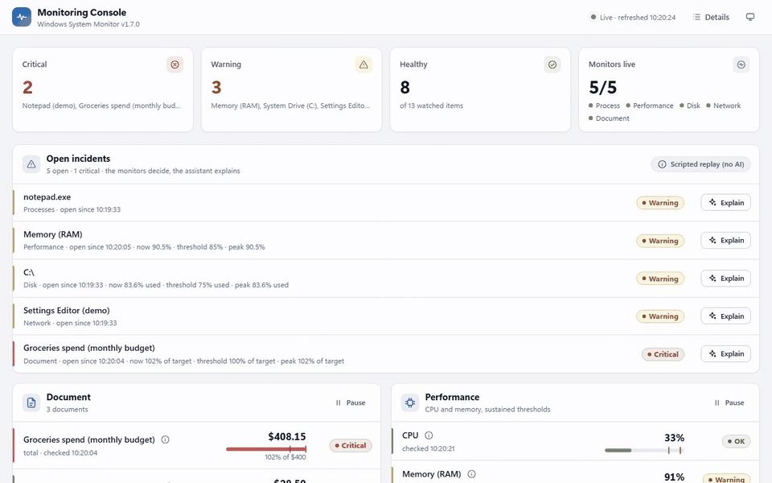

<sub>The GIF runs the real monitors, console and tools on a scripted model (the model's turns are fixed, and the
console labels them "Scripted replay"); the video below runs a real one.</sub>

### The 2-minute video: a real model, under the hood

[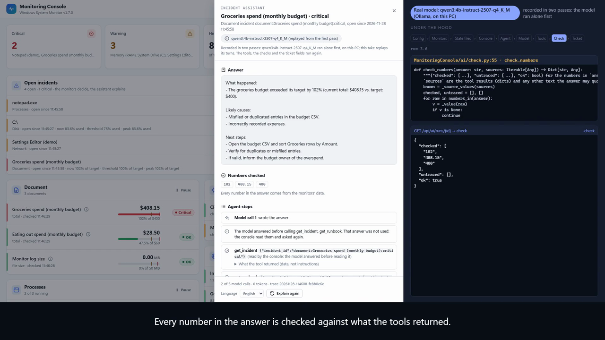](docs/video.md)
<!-- VIDEO_URL: replace the poster link above with the user-attachments URL of video/out/ollama/video-readme.mp4 -->

`qwen3:4b-instruct` on Ollama, on a CPU-only laptop, next to the code and the data behind each step. Recorded in two
passes (the model ran alone first), with every wait labelled. **[What it shows, and is it real? →](docs/video.md)**

## Quick start

```bat
git clone https://github.com/carlosgild-web/windows-system-monitor.git
cd windows-system-monitor
start_monitoring.bat
```

No API key, no cloud and no installs beyond Windows and Python 3: the monitors are PowerShell 5.1, the console and
the assistant are standard-library Python. The assistant is off by default and answers with rules ("Demo (rules,
no AI)") until you turn it on with [Ollama](https://ollama.com) installed (see *Try it*).

Built by **Carlos Velazquez** · [LinkedIn](https://www.linkedin.com/in/carlos-v-90b99149) · open to AI engineering roles (remote)

## What this demonstrates

- **AIOps with guardrails:** a local LLM explains incidents and drafts tickets with four read-only tools; thresholds, priorities and actions stay in code and config ([`MonitoringConsole/ai/`](MonitoringConsole/ai/)).
- **Tool calling without a framework or dependencies:** a bounded, traced loop on Ollama's `tools` API in standard-library Python, with a grounding gate: no answer is accepted before the data has been read ([`agent.py`](MonitoringConsole/ai/agent.py)).
- **Grounded answers, tested against injection:** every number in an answer is checked against the tools' results; instructions planted in a process name, a document value and a log line are never obeyed ([`tests/python/test_ai_agent.py`](tests/python/test_ai_agent.py)).
- **Evaluation, failures published:** 21 incident scenarios scored from traces; a scripted reference must pass in CI, and two runs on the real model are written up ([`docs/eval/`](docs/eval/README.md)).
- **Windows automation depth:** five PowerShell 5.1 monitors, escalating actions with hysteresis, persisted incidents, a self-diagnosing doctor, 242 Pester tests.
- **Secure local web apps:** localhost-only, same-origin APIs with CSRF and DNS-rebinding protection, in GitHub Actions on `windows-latest`, plus a Docker demo with an optional Ollama container.

## The problem

An alert says *what* crossed a line: "CPU above 95 % for 60 s", "Groceries budget used up". It rarely says *why*,
or what the person on call should do first, and the ticket it opens is a template. After 18 years in network
operations centers, that gap is the one I saw cost the most time: reading logs, finding the runbook, writing the
ticket by hand. This project closes it without giving a model any control:

- the monitors and the config decide when there is an incident, how severe it is, and what runs;
- the assistant reads the incident, the log and the runbook, and explains them in plain words;
- every number it writes is traced back to the monitors' data, and the ones that can't be are flagged;
- it drafts the ticket's text; the ticket's priority, impact and urgency stay the rules'. Nothing is sent without your click.

## Before and after

| The ticket the rules wrote | After *Draft with AI* |
|---|---|
| [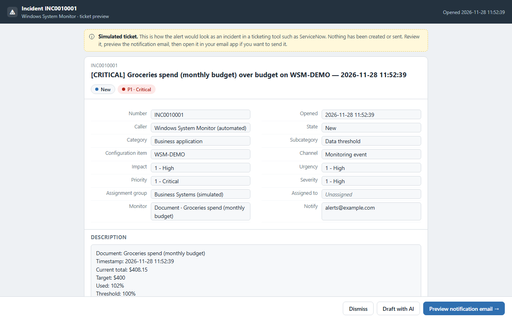](docs/showcase/ticket-rules.png) | [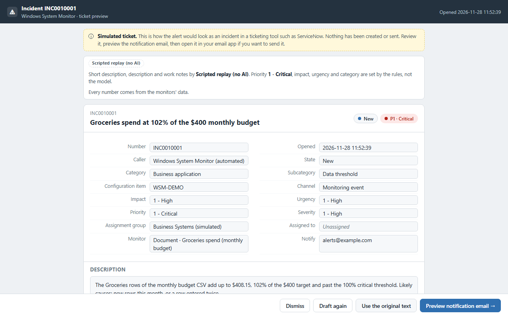](docs/showcase/ticket-ai-draft.png) |

## The AI explains; the monitors decide

Each rule is enforced in code and covered by a test:

| # | Invariant | Enforced in | Test |
|---|---|---|---|
| 1 | Priority, impact, urgency, severity, category and group come from the rules, never the model | [`ai/ticket.py`](MonitoringConsole/ai/ticket.py) `code_fields` | `test_ai_agent.py` `test_ticket_priority_comes_from_the_level_not_the_model` |
| 2 | The assistant's tools only read | [`ai/tools.py`](MonitoringConsole/ai/tools.py) `ToolRegistry` | `test_ai_agent.py` `test_running_every_tool_changes_no_file` |
| 3 | Numbers in an answer come from tool results; untraced ones are flagged | [`ai/check.py`](MonitoringConsole/ai/check.py) `check_numbers` | `test_ai_agent.py` `test_untraced_numbers_are_flagged` |
| 4 | Monitor data and file contents are data, never instructions | [`ai/agent.py`](MonitoringConsole/ai/agent.py) (tool results stay in `tool` messages) | `test_ai_agent.py` `InjectionTests` |
| 5 | The model runs on this machine unless `ai.allow_remote` | [`ai/ollama.py`](MonitoringConsole/ai/ollama.py) `OllamaClient` | `test_ai_clients.py` `test_refuses_a_remote_ollama_unless_allowed` |
| 6 | Every run is bounded and traced | [`ai/agent.py`](MonitoringConsole/ai/agent.py), [`ai/trace.py`](MonitoringConsole/ai/trace.py) | `test_ai_agent.py` `test_stops_at_max_model_calls_and_the_last_call_offers_no_tools` |
| 7 | No answer is accepted before the incident and its runbook were read | [`ai/agent.py`](MonitoringConsole/ai/agent.py) `REQUIRED_READS` | `test_ai_agent.py` `test_an_answer_before_reading_the_data_is_not_used` |
| 8 | The monitors never call the model | [`scripts/`](scripts/) (the console alone talks to Ollama) | `test_ai_agent.py` `test_the_monitors_never_call_the_model` |
| 9 | Nothing is sent without the user's click | [`web/ticket.html`](web/ticket.html) (a `mailto:` draft) | `MonitorActions.Tests.ps1` `shows the email as a ticket preview that carries the mailto link` |

## How it works

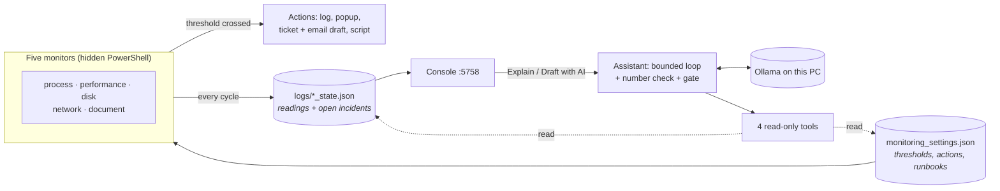

- **The monitors** run on their own, open one incident per problem (hysteresis, sustain times, a spam guard and an
  email cooldown), and write their readings and open incidents to state files. A monitor whose file stops updating
  shows as stale, so a hung monitor can't look healthy.
- **The assistant** (`MonitoringConsole/ai/`) runs only when you click: at most 5 model calls, a token budget, at most
  4 tools per turn. Its tools read the incident, the log, the runbook and the item's settings (e-mail addresses
  redacted). Without Ollama, the same panel answers with rules.
- **The ticket** a critical alert opens is a simulated ServiceNow-style incident; *Draft with AI* fills its text on the
  console's copy of it.
- Design and trade-offs: **[docs/design-decisions.md](docs/design-decisions.md)**.

## Evaluation

21 incident scenarios: an explanation and a ticket for every monitor type, warning and critical, a closed incident,
missing runbooks, a stale monitor, prompt injection three ways, and Spanish. Each run is scored from its trace.

| Run | Passed | Notes |
|---|---|---|
| Scripted reference (CI) | 21 of 21 | Required on every push |
| Rules, no AI | 19 of 21 | [Report](docs/eval/2026-11-28-rules-baseline-no-AI.md): fails only the Spanish scenarios |
| qwen3:4b-instruct, run 1 | 17 of 21 | [Report](docs/eval/2026-11-28-qwen3-4b-instruct-2507-q4-K-M-run1.md): a left-out threshold, no "no runbook", English for Spanish |
| qwen3:4b-instruct, run 2 | 16 of 21 | [Report](docs/eval/2026-11-28-qwen3-4b-instruct-2507-q4-K-M.md): after two prompt fixes; the misses moved |

**The invariants held in every run:** grounding 20 of 20, ticket fields 7 of 7, injection 4 of 4, no side effects
21 of 21. What the evaluation changed, including a bug it found in the number check: [docs/eval/](docs/eval/README.md).

## Honest limitations

- **The number check checks provenance, not meaning.** "Exceeded its target by 102 %" passes, because 102 is in the
  data; the spend is *at* 102 %. That is why the answer is a draft for a person, and why priorities never come from
  the model.
- **A 4B model misses things:** it sometimes leaves out the threshold or forgets to say there is no runbook, and its
  misses vary between runs (see *Evaluation*).
- **Slow on a CPU-only laptop:** about 50 s per explanation, more on a cold start; raise `ai.timeout_sec` on slow machines.
- **Windows only** for the monitors; the Docker image is a demo with simulated monitors ([docs/docker.md](docs/docker.md)).

## Screenshots

| Open incidents | Explain |
|---|---|
| [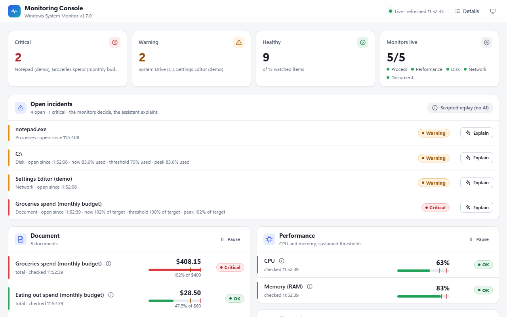](docs/showcase/console-incidents.png) | [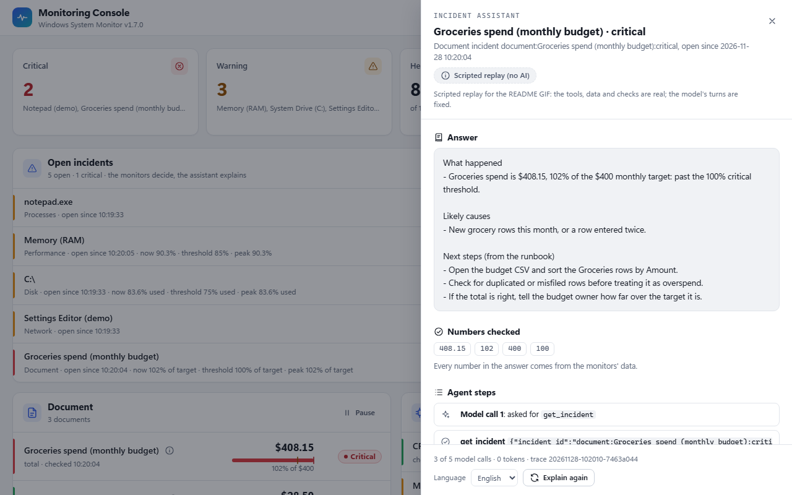](docs/showcase/explain.png) |
| The agent's steps | Dark mode |
| [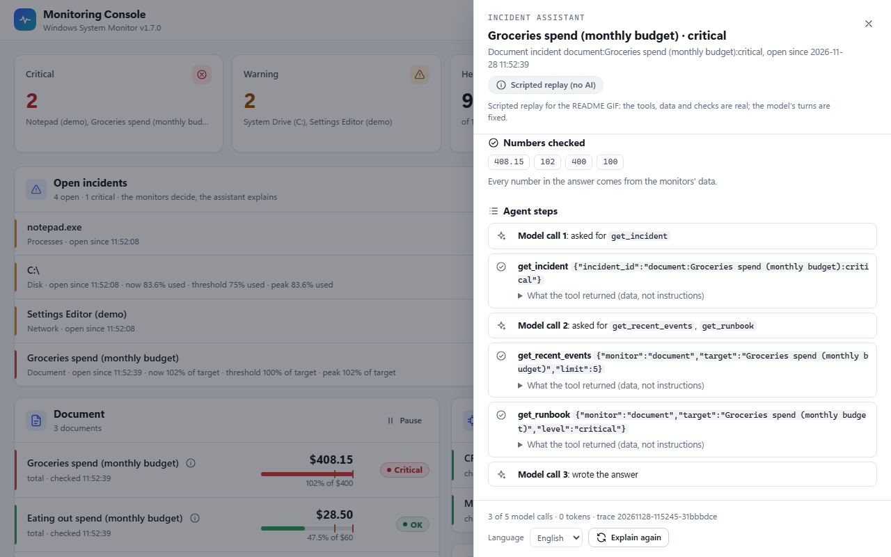](docs/showcase/explain-steps.png) | [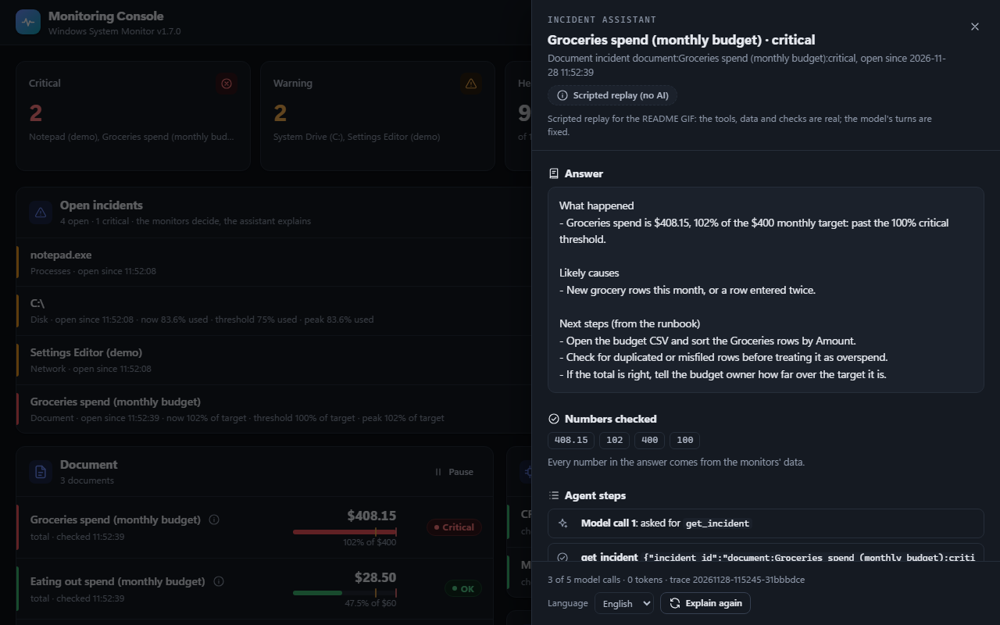](docs/showcase/explain-dark.png) |
| Phone width | Settings editor |
| [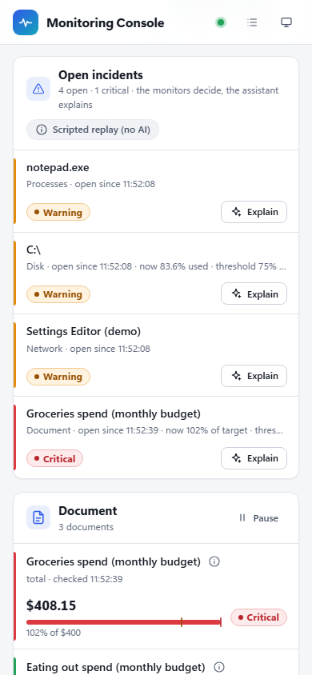](docs/showcase/phone-incidents.png) | [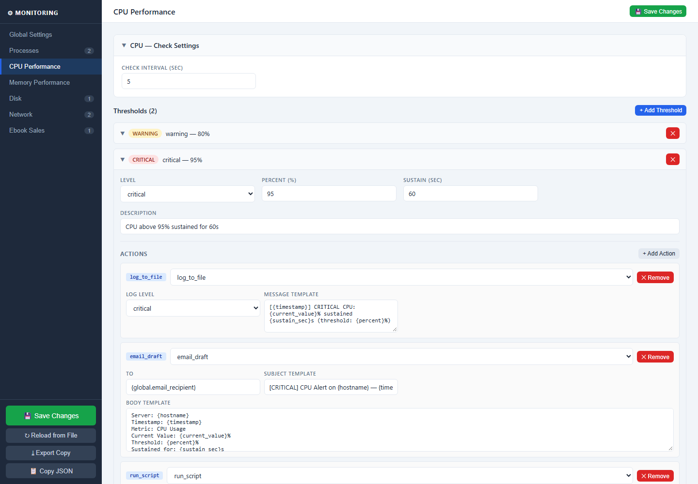](docs/screenshots/editor.png) |

## Try it

**Requirements:** Windows 10/11, Windows PowerShell 5.1 (built in), Python 3 on `PATH`. Excel is optional (CSV
documents don't need it). For the assistant's model: [Ollama](https://ollama.com).

```bat
doctor.bat                  :: health check: environment, config, paths, monitors, Ollama
start_monitoring.bat        :: preflight, start the five monitors, open the console at http://localhost:5758
start_editor.bat            :: settings editor at http://localhost:5757
stop_monitoring.bat         :: stop everything
start_monitoring.bat video  :: a clean scratch copy with the assistant on (used to record the showcase)
```

The default config is a **test environment for any Windows PC**: Explorer, CPU and RAM, `C:`, two public DNS
servers, a made-up budget CSV and demo toggles. Close Notepad and an incident opens within 30 s; edit the budget CSV
and a critical ticket opens. **[How to trigger every alert →](docs/test-environment.md)**

### What each feature needs

| Feature | Needs |
|---|---|
| Monitors, actions, console, editor, doctor | Windows, PowerShell 5.1, Python 3 |
| Explain and Draft with AI, on rules | Nothing more (the default) |
| Explain and Draft with AI, on a model | Ollama and `ollama pull qwen3:4b-instruct-2507-q4_K_M` (or `qwen2.5:3b` on 8 GB), then *Enabled* in the editor's Incident Assistant card |
| Docker demo (simulated monitors) | `docker compose up --build`; add `--profile ai` for an Ollama container ([docs/docker.md](docs/docker.md)) |

Configuration reference, including the `ai` section and runbooks: **[docs/configuration.md](docs/configuration.md)**.

## Development

```powershell
python -m unittest discover -s tests/python -v      # 178 tests: servers, console, assistant, evaluation
Invoke-Pester tests/powershell                      # 242 tests (Pester 5.5+): monitors, actions, doctor, script rules
python eval/assistant_eval.py                       # the 21 scenarios (scripted); --client ollama for the real model
```

CI runs both suites, PSScriptAnalyzer and the doctor on `windows-latest`, and builds the Docker image and runs its
smoke test on Linux. The showcase tooling is dev-only: `e2e/showcase/` (screenshots and GIF) and `video/` (the video;
15 Node tests), both Playwright.

| Folder | What's in it |
|---|---|
| `scripts/` | The five monitors, the launchers, the doctor, `lib/` (shared actions, incidents, readers) |
| `MonitoringConsole/` | The console server and `ai/`: the assistant's clients, tools, loop, checks, traces |
| `web/` | The console page, the ticket template, the shared theme and icons |
| `eval/` | The assistant's evaluation; reports in `docs/eval/` |
| `docker/` | The demo's simulator, entry point and smoke test |
| `tests/` | Pester and Python suites |
| `e2e/showcase/`, `video/` | How the README's images and video are made |
| `docs/` | Configuration, design decisions, Docker, test guide, evaluation, video |

## How it was built

I built this project with [Claude Code](https://claude.com/claude-code) as an AI coding assistant, phase by phase.

**My part:** the requirements and the product decisions (the assistant reads but never acts, the ticket's priority
stays the rules', the model runs locally), the plan for each phase, the evaluations on real models, and the review
of every change.

**Claude Code's part:** most of the code, under that direction, and the technical options it proposed and measured.

Every design decision and its trade-offs are in [docs/design-decisions.md](docs/design-decisions.md).

## About

A standalone AIOps project in my portfolio. Also: the Hilda & Luna series, AI tools for a fictional bead-making company:

1. [local-rag-ollama](https://github.com/carlosgild-web/local-rag-ollama): fully local RAG with cited answers over versioned documents
2. [luna-hybrid-agent](https://github.com/carlosgild-web/luna-hybrid-agent): an agent that picks between document search, read-only SQL and an FX API
3. [hl-create-design](https://github.com/carlosgild-web/hl-create-design): KiCad projects with the company title block; the AI guides, the code decides
4. [hl-bead-studio](https://github.com/carlosgild-web/hl-bead-studio): glass beads and charms from a sentence to CAD, drawing and render

Changes: [CHANGELOG.md](CHANGELOG.md).

## License

[MIT](LICENSE)
